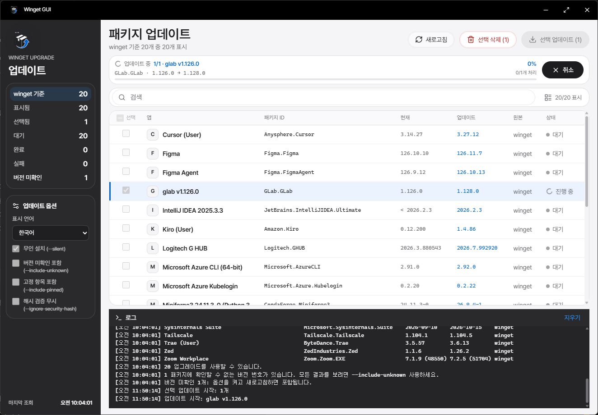

# Winget GUI

A small Windows desktop app (Tauri 2 + React, Rust backend) that puts a GUI on top of `winget`, so you can pick exactly which packages to update instead of upgrading everything at once.



The update banner shows the current package, version change, and overall queue
progress. The cancel button and raw `winget` log stay visible while an update is
running.

## Features

- Shows everything from `winget upgrade` with name, package ID, installed version, available version, and source
- Check only the packages you want and update them one at a time
- Search by name, ID, or version
- Uninstall selected apps, or reinstall apps that winget can't upgrade in place
- Options for silent install, unknown versions, pinned packages, and skipping the hash check
- Per-package status plus the raw `winget` log
- UI in Korean and English
- A single ~7 MB exe that starts instantly — nothing is unpacked on launch

## Requirements

- Windows 10/11 with `winget` available
- WebView2 runtime (included with Windows 11; preinstalled on most Windows 10 machines)
- For development: Node.js/npm and the Rust stable toolchain (MSVC)

## Running

```powershell
npm install
npm start
```

`npm start` runs `tauri dev`: it starts the Vite dev server and launches the app with hot reload. Opening `dist/index.html` in a browser won't do anything useful — the app needs its Rust backend to talk to `winget`.

## Building

```powershell
npm run portable      # release\Winget-GUI-Portable-<version>-x64.exe
npm run release:win   # portable exe + release\Winget-GUI-Setup-<version>-x64.exe (NSIS)
```

The portable exe is a single file: copy it anywhere and double-click it. No installation needed.

## Administrator rights

Release builds always ask for elevation (UAC) on launch, since installing and removing packages often requires admin rights.

In development mode (`npm start`) the app starts unelevated. Use the "Restart as Admin" button inside the app if you need elevation there.

Because the app runs elevated, it resolves `winget.exe` from the admin-only `WindowsApps` install first and runs it from `System32`, so a planted `winget.exe` elsewhere on `PATH` is not picked up. The build isn't code-signed, so keep the exe in a location regular users can't write to.

## How updates run

Each selected package is updated one at a time by its exact ID:

```powershell
winget upgrade --id <PackageId> --exact --accept-package-agreements --accept-source-agreements --disable-interactivity --silent
```

Depending on the options you enable, these flags are added:

| Option | winget flag | What it does |
| --- | --- | --- |
| Silent install | `--silent` | Skips installer prompts when the installer supports it. |
| Include unknown versions | `--include-unknown` | Includes packages whose installed version can't be detected. |
| Include pinned | `--include-pinned` | Includes pinned packages when winget doesn't block them. |
| Ignore hash check | `--ignore-security-hash` | Installs even when the installer hash doesn't match the manifest. Use only for sources you trust. |

When winget truncates a package ID in its table output, the app resolves the full ID from `winget export`, then `winget list`, then `winget search` before acting on it; IDs that stay ambiguous are refused.

When winget reports that a package's install technology changed (so an in-place upgrade is impossible), the app offers a reinstall instead: it uninstalls the app and then installs the latest version fresh, after a confirmation dialog.

## Tests

```powershell
npm test            # renderer, i18n, and release config tests
npm run test:rust   # Rust parser, resolver, args, and runner tests
```

Pull requests run both suites plus `cargo clippy` and a Tauri build in GitHub Actions.

## Contributing

Read [AGENTS.md](AGENTS.md) for project-specific validation, issue/PR, and release
rules. [CLAUDE.md](CLAUDE.md) imports the same instructions.

Choose the bug, change, or question form when opening an issue. Pull requests
use the repository template for the summary, changes, acceptance criteria,
verification, impact, and remaining limitations. Issue and PR descriptions are
written in Korean with a short summary at the top.

The common guidelines and forms are adapted from
[Project Starter Kit](https://github.com/dydtjr1128/project-starter-kit/tree/f39b580c4a836fc5e13527eb45fdcc63d3e0f1e4/templates/common).
They are maintained as local copies; compare upstream changes and preserve this
project's validation and release rules when updating them.

## Project layout

```text
src-tauri/             Tauri app: Rust winget backend (parser, resolver, args, runner) and config
src/                   React renderer UI; src/tauriBridge.mjs is the backend API boundary
public/                Static app icon
build/                 App icon used for the exe and installer
docs/images/           Screenshots for the README
scripts/               Release artifact collection
tests/                 Renderer and release config tests
release/               Build output
```
